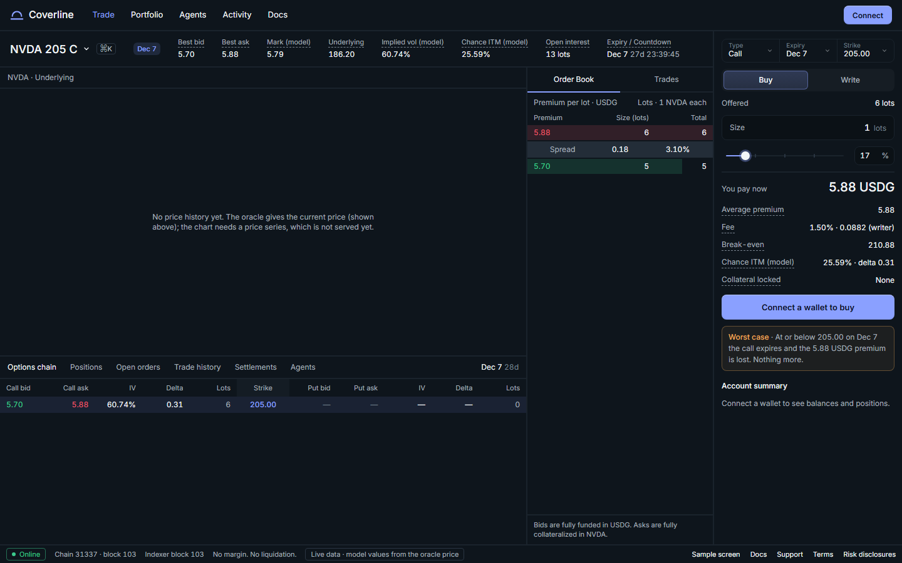
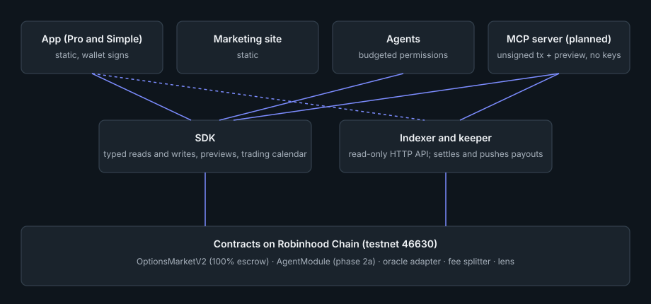

# Coverline

**Fully collateralized options for tokenized stocks on Robinhood Chain.** Holders earn a premium by writing covered
calls and cash-secured puts; buyers get defined-risk exposure. Every action shows what you receive or pay, when, and
the worst case, before you sign.

> **Status: testnet only.** Coverline runs on the Robinhood Chain testnet (chain 46630) with test assets that have no
> value. There is no mainnet deployment. This repository is a showcase: it contains no source code. The source
> repositories are private; reviewers can get read access on request.

| Simple view: "Earn on my tokens" | The same ticket on a phone |
| --- | --- |
|  |  |

*Screenshots are from the automated browser tests on a local test chain with sample data.*

## What it does
- **Covered calls and cash-secured puts, 100% escrowed.** No margin, no liquidations. Lots, partial fills, bids and
  sell-to-bid, cancel and buy-back-to-close at any time.
- **Oracle settlement with a grace window.** If no price report is close enough to expiry, settlement is deferred
  instead of using a stale price.
- **Standard expiries follow the US trading calendar.** Fridays at the market close, moved for holidays and early
  closes, from the exchange's published table.
- **Plain previews.** The SDK simulates every order first and states: you pay, you receive, when, worst case.
- **Budgeted agents (phase 2a).** An owner can let an agent write or buy within permissions, budgets and an expiry.
  Funds never go to the agent.
- **Honest about issuer controls.** Stock Tokens are tokenized debt securities whose issuer can pause, block or burn
  tokens. If escrowed tokens are burned, payouts are pro rata; the app says so wherever it shows a worst case.

## Architecture

| Part | What it is |
| --- | --- |
| Contracts (Solidity, Foundry) | `OptionsMarketV2` (escrow, order book, settlement), `AgentModule` (agent permissions), oracle adapter, fee splitter, read lens |
| SDK (TypeScript) | Typed reads and writes, simulate-before-sign previews, trading calendar, indexer client |
| Indexer and keeper | Reorg-safe indexer with a read-only HTTP API; a keeper that settles and pushes payouts |
| App | Pro and Simple views, Portfolio, Activity, Agents, Settings; desktop and phone |
| UI package | Accessible components (WCAG 2.2 AA checks in CI) |
| MCP server (planned) | Lets AI clients read the market and prepare **unsigned** transactions with the full preview. It holds no keys and never sends |

## Testnet deployment (Robinhood Chain testnet, chain 46630)
Current set, deployed 2026-11-10. Test assets only.

| Contract | Address |
| --- | --- |
| OptionsMarketV2 | `0x313a18f3aa23bb65D3f5031A5cB2743ad3a4c3c3` |
| ChainlinkOracleAdapter | `0x79C8fA8af8B845aFdcF5f126aB591e58Cf2B47D9` |
| FeeSplitter | `0x69686F71820879E5b8Fc1A6F175F7beaa83E3d29` |
| MarketLens | `0xeC16b08c85Eb23c28485ab9841771A6321D30DA6` |

The quote token and the price feed on the testnet are mocks, used on the testnet only. A redeploy with the
`AgentModule` (phase 2a) is planned; this table will change then.

## Engineering (2026-11-16)
| Area | State |
| --- | --- |
| Contracts | 164 tests: unit, fuzz and 12 invariants (solvency, agent budgets); static analysis triaged with no high-severity finding; tests on a fork against real Robinhood Chain assets |
| SDK | 674 tests; a weekly differential run compares the SDK's maths with the contracts: 0 differences |
| Indexer and keeper | Weekly soak with chain reorganisations, deferred settlements and a simulated issuer burn; the end state equals fresh chain reads |
| App | Browser end-to-end tests on recorded data and, weekly, the full demo flow on a fork of the testnet; accessibility checks on every page |
| Process | Small reviewed pull requests, CI on every repository, written product and design decisions |

**Not done yet:** external audit, legal review, mainnet. No users and no TVL: testnet only.

## Availability
Coverline is not available in the US or to US persons, Canada, the United Kingdom or Switzerland, and not to
investors in Cuba, Belarus, Iran, North Korea, Russia, Syria, Ukraine, South Sudan, Sudan, Myanmar or Venezuela.
Further restrictions may apply. Nothing here is an offer or advice.

## Access and contact
The source repositories are private. For read access as a reviewer, open an issue in this repository.
